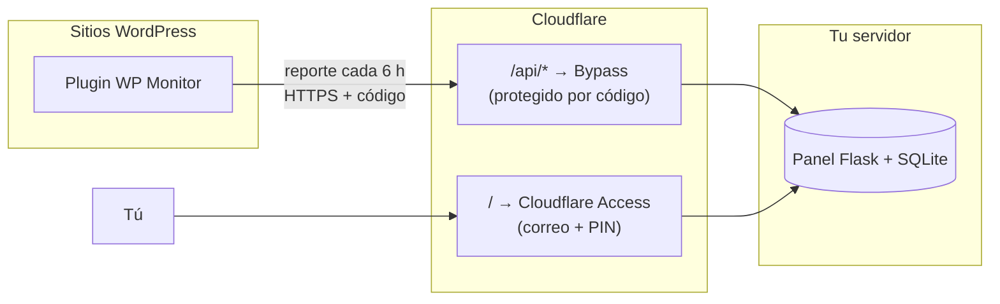

# WP Monitor

**Panel central para vigilar todos tus sitios WordPress en un solo lugar**: actualizaciones pendientes, respaldos, cuota de disco, certificado SSL y señales de seguridad.

Cada sitio se conecta con **dos datos: servidor y código**. Sin SSH, sin acceso al hosting del cliente y sin abrir nada en el sitio.

> Hecho por [Ilderim Digital Solutions](https://ilderim.mx) para administrar los sitios de sus clientes. Licencia GPL-2.0.

<!-- Agrega una captura del panel con datos de prueba en docs/panel.png y descomenta la siguiente línea -->
<!--  -->

---

## ¿Qué revisa?

| Área | Qué vigila |
|---|---|
| **WordPress** | Versión instalada y si hay actualización del núcleo |
| **Plugins** | Total, activos y cuáles tienen actualización pendiente |
| **Respaldos** ([Backuply](https://wordpress.org/plugins/backuply/)) | Último respaldo, si fue automático o manual, destino (local / nube), si hay respaldos **programados**, respaldos atorados y copias locales que ocupan espacio |
| **Disco** | Cuota real de la cuenta cPanel (vía `uapi`), tamaño de `uploads` y de la carpeta de respaldos |
| **SSL** | Fecha de vencimiento y días restantes |
| **Seguridad** | Administradores (alerta si aparece uno nuevo), usuarios nuevos en 24 h, comentarios spam |
| **Disponibilidad** | Alerta si un sitio deja de reportar |

Cada sitio aparece en el panel como una tarjeta con semáforo: 🔴 **Crítico**, 🟡 **Revisar**, 🟢 **Todo bien**.

<details>
<summary><b>Reglas de alerta</b></summary>

| Nivel | Condición |
|---|---|
| 🔴 Crítico | No reporta en más de 24 h · Backuply no instalado · sin respaldos programados · último respaldo hace más de 14 días · respaldo atorado · 5 o más plugins pendientes · cuota de disco ≥ 90 % · SSL vence en menos de 7 días · **nuevo administrador** · código usado desde otra URL |
| 🟡 Revisar | No reporta en más de 12 h · WordPress o plugins pendientes · último respaldo hace más de 8 días · cuota ≥ 80 % · SSL vence en menos de 21 días · usuarios nuevos en 24 h · respaldos locales ≥ 300 MB |

</details>

---

## Cómo funciona



El plugin **envía** su reporte al panel (modelo *push*). El sitio no expone ningún endpoint, así que no hay nada que proteger ni que se pueda filtrar por caché.

### Dos puertas, un solo dominio

- **Puerta de los sitios (`/api/`)**: Cloudflare la deja pasar sin login, pero el panel exige un **código válido**. Con el código, un sitio **solo puede enviar su propio reporte**: no puede leer nada.
- **Tu puerta (todo lo demás)**: protegida por **Cloudflare Access** (correo + PIN). Además, el panel **verifica la firma JWT de Access** en cada visita y **falla cerrado**: si Access estuviera mal configurado, nadie entra.

### Los códigos

- Se generan en la página **Sitios** del panel y se muestran **una sola vez**.
- El panel guarda solo su huella SHA-256, nunca el código.
- **Primer uso = amarre**: el código queda ligado a la URL del primer sitio que lo usa. Si otro sitio lo intenta usar, se rechaza y aparece una alerta.
- Se pueden **regenerar**, **revocar** o **liberar** (si el cliente cambia de dominio).

---

## Instalación del panel

### Requisitos

- Un servidor Linux con **Docker** (funciona en 1 GB de RAM; el panel usa ~60 MB).
- Un dominio en **Cloudflare** y una cuenta de **Cloudflare Zero Trust** (el plan gratuito alcanza).
- **Cloudflare Tunnel** (`cloudflared`) en el servidor. No hace falta abrir puertos.

### 1. Descargar y configurar

```bash
git clone https://github.com/ilderim-mx/wp-monitor.git
cd wp-monitor/server
mkdir -p data && sudo chown 10001:10001 data
cp .env.example .env && chmod 600 .env
nano .env
```

| Variable | Valor |
|---|---|
| `CF_ACCESS_TEAM_DOMAIN` | Tu dominio de equipo, ej. `miequipo.cloudflareaccess.com` |
| `CF_ACCESS_AUD` | *Application Audience (AUD) Tag* de la aplicación de Access del panel (paso 3) |
| `ADMIN_EMAILS` | Correos que pueden administrar el panel, separados por comas |
| `PUBLIC_HOST` | El dominio del panel, ej. `panel.midominio.com` |

### 2. Arrancar

```bash
docker compose up -d --build
curl -s -o /dev/null -w "%{http_code}\n" localhost:8082/                     # 403 (sin login): correcto
curl -s -o /dev/null -w "%{http_code}\n" -X POST localhost:8082/api/v1/report  # 401 (sin código): correcto
```

El panel escucha solo en `127.0.0.1:8082`; nadie llega a él si no es a través del túnel.

### 3. Cloudflare

1. **Túnel** → *Rutas de aplicaciones publicadas*: `panel.midominio.com` → `HTTP` → `localhost:8082`.
2. **Access → Aplicaciones → Autoalojada** para el panel:
   - Destino: `panel.midominio.com`
   - Política **Allow** → *Correos electrónicos* → tu correo
   - Copia su **AUD** al `.env` y reinicia con `docker compose up -d`.
3. **Access → Aplicaciones → Autoalojada** para la API:
   - Destino: `panel.midominio.com` con ruta **`api`**
   - Política **Bypass** → *Todos*

Comprueba que todo quedó bien:

```bash
curl -s -X POST https://panel.midominio.com/api/v1/report   # {"error":"no_code"}  → la API responde
curl -s -o /dev/null -w "%{http_code}\n" https://panel.midominio.com/  # 302 → Access protege el panel
```

> **Recomendado:** agrega una regla de *rate limiting* de Cloudflare para `/api/*`.

---

## Conectar un sitio

1. En el panel → **Sitios** → escribe el nombre del cliente → **Agregar y generar código**. Copia el código.
2. En el WordPress, instala el plugin: sube `plugin/monitor-status/` como zip (*Plugins → Añadir nuevo → Subir plugin*).
3. **Ajustes → WP Monitor** → Servidor: `panel.midominio.com` · Código: el que copiaste → **Guardar y conectar**.
4. Debe aparecer **"Conectado como «nombre»"**. El sitio reporta solo cada 6 horas.

> Cambia el servidor por defecto en `WPM_DEFAULT_SERVER` dentro del plugin si lo vas a distribuir con tu propio dominio.

---

## ¿Qué datos se envían?

El plugin envía **solo metadatos de administración**: versiones de WordPress y plugins, estado de respaldos, uso de disco, vencimiento del SSL, conteo de usuarios y comentarios, el correo de administración del sitio y la versión de PHP.
**No envía** contenido, contraseñas, datos de usuarios, ni credenciales de respaldo.

El panel conserva los **últimos 20 reportes** por sitio.

---

## Notas técnicas

- **Cuota de disco**: se lee con `uapi Quota get_quota_info` de cPanel. Si el hosting no lo permite (sin cPanel o con `shell_exec` deshabilitado), el panel muestra "—" en lugar de un dato inventado.
- **WP-Cron** depende de las visitas al sitio. En sitios con poco tráfico conviene un cron real del sistema (`wp cron event run --due-now`).
- **LiteSpeed Cache / Cloudflare**: como el plugin no expone endpoints, no hay riesgo de que una caché sirva datos privados.

---

## Hoja de ruta

- [ ] Notificaciones por correo (SMTP) cuando un sitio pasa a crítico
- [ ] Vista por cliente: cada cliente ve solo sus sitios con su propio acceso
- [ ] Ping de disponibilidad desde el panel
- [ ] Gráficas de historial

---

## Licencia

[GPL-2.0-or-later](LICENSE). El plugin de WordPress debe distribuirse bajo GPL; el panel usa la misma licencia por simplicidad.
